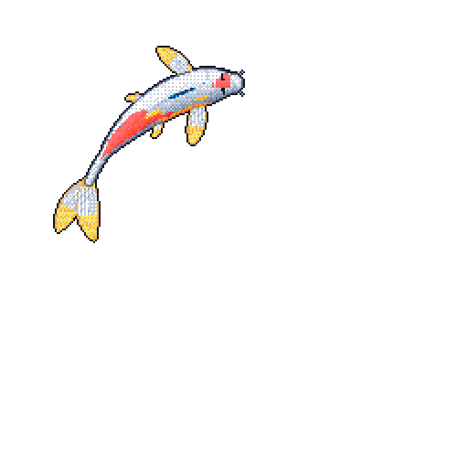

<h2 align="center">John DSouza</h2>

  CS @ Georgia Tech (AI + Cybersecurity)

  

  <a href="https://www.linkedin.com/in/YOUR-LINKEDIN">LinkedIn</a> ·
  <a href="mailto:jdsouza_07@gatech.edu">Email</a>

<!--
**jdsouz07/jdsouz07** is a ✨ _special_ ✨ repository because its `README.md` (this file) appears on your GitHub profile.

Here are some ideas to get you started:

- 🔭 I’m currently working on ...
- 🌱 I’m currently learning ...
- 👯 I’m looking to collaborate on ...
- 🤔 I’m looking for help with ...
- 💬 Ask me about ...
- 📫 How to reach me: ...
- 😄 Pronouns: ...
- ⚡ Fun fact: ...
-->
